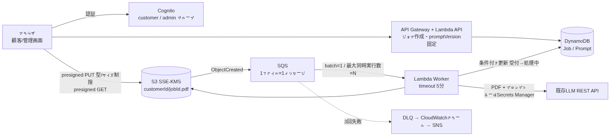
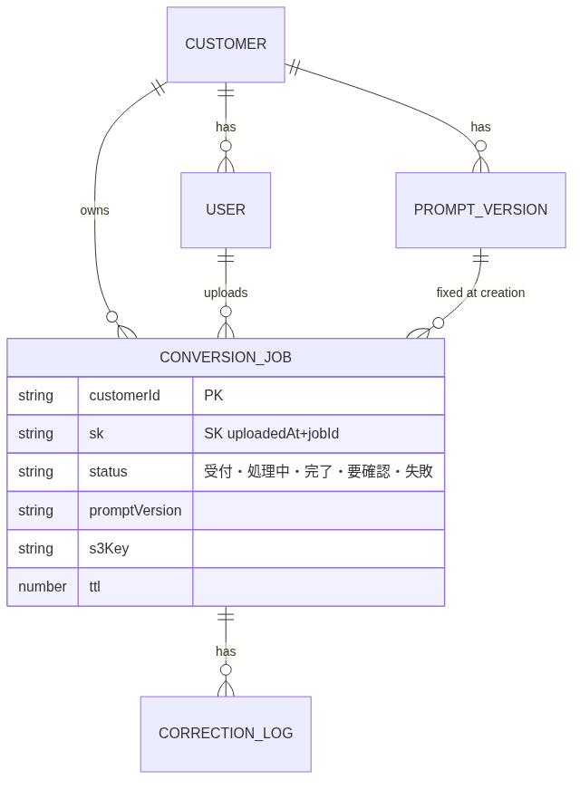

# route-D 設計課題：FAX注文書PDF → CSV 変換システム アーキテクチャ設計案

## 1. 前提整理・不明点（質問 → 仮の回答）
| # | 不明点 | 仮定 |
|---|---|---|
| Q1 | LLM APIの並列数・RPM・TPM | 並列30以上可。Nはこれらから算出し設定値化 |
| Q2 | 顧客数・ピーク・公平性 | 数十〜数百社、ピークは1社30件×数社。1社の大量投入で他社を待たせない |
| Q3 | PDFサイズ・入力形式 | 数MB・数ページ以内。APIがPDF直接入力可か、FAX画質でOCR前処理が要るか要確認 |
| Q4 | LLMのデータ取扱い | 学習利用なし・処理リージョン国内を契約で確認 |
| Q5 | プロンプト変更時 | ジョブ作成時に版を固定・記録。再変換は任意操作 |
| Q6 | CSV列定義・品番マスタの責任者 | 顧客ごとの列定義・品番マスタは顧客側が提供、route-D管理者が登録 |
| Q7 | 保持・分離 | PDF/CSVは1年保持。顧客IDで論理分離 |
| Q8 | 人の確認 | 必要。「要確認」ステータスを持つ |
| Q9 | コスト・予算・SLA | 月額予算上限と完了目安（例 30件を10分以内）を合意 |

## 2. 結論
**S3直接アップロード → SQSに1ファイル1メッセージ → Lambdaを最大同時実行数Nで並列実行しLLM呼び出し → CSVはS3、メタデータはDynamoDB → 画面はポーリング。** 管理画面はCognitoグループで分離、プロンプトは版管理。

 

## 3. 理由（前提との対応）
- **非同期**：SQS+Lambdaでサーバ側完結、状態はDBに永続化。ブラウザを閉じてよい。
- **流量制御**：Lambda予約同時実行数ではなく、**SQSイベントソースの最大同時実行数=N**（Q1のRPM/TPM/並列上限から算出）。超過分はSQSで待機。429はRetry-Afterに従う。
- **DynamoDB**：アクセスは「顧客ID×日時降順の一覧」と単件更新のみ（PK=customerId, SK=uploadedAt#jobId）。集計が増えればRDS/Athena。
- **人の確認**：自動検証（列数・型・必須・品番マスタ照合）で「要確認」、修正ログをプロンプト改善へ。

## 4. データフロー
1. **アップロード**：APIがジョブ作成（status=受付、**promptVersionをこの時点で固定**）→ presigned PUT（Content-Type=application/pdf・サイズ上限を条件化）→ S3 `customerId/jobId.pdf` へ直接PUT。
2. **変換**：S3イベント→SQS（batch size=1, ReportBatchItemFailures）→ Workerが**条件付き更新（受付→処理中）**に成功した場合のみLLM呼び出し→自動検証。
3. **保存**：CSVをS3、Jobを完了/要確認/失敗に更新。
4. **一覧・プレビュー**：数秒間隔ポーリング、customerIdで日時降順Query。PDFは権限確認後にpresigned GET。
5. **管理**：adminのみ。プロンプト編集＝新バージョン作成。
6. **放置ジョブ**：PUTされず「受付」のままのジョブはTTL／定期チェックで期限切れにする。

## 5. 非同期・エラー処理・運用
- Lambdaタイムアウト5分、**可視性タイムアウト=30分（6倍）**。
- **エラー分類**：429・5xx・タイムアウトはリトライ（ChangeMessageVisibilityでバックオフ、maxReceiveCount=3→DLQ）。破損PDF・サイズ超過・検証失敗はリトライせず即「失敗」or「要確認」。
- **冪等性**：上記条件付き更新で二重実行を防止。結果はjobIdキーで上書きのみ。
- **監視**：DLQ件数・最古メッセージ経過時間にCloudWatchアラーム→SNS。DLQは原因確認後にredrive（再投入）する手順を用意。
- **セキュリティ**：S3はSSE-KMS・パブリックアクセスブロック、LLM APIキーはSecrets Manager。

## 6. トレードオフ
- Lambda vs Fargate：Lambdaは簡単・自動スケール。15分超・大容量ならFargate。
- ポーリング vs WebSocket：まず単純なポーリング、件数増でAPI Gateway WebSocket。
- SQS+Lambda vs Step Functions：工程が少ない今はSQS。OCR・分割・検証など工程が増えればStep Functions（Map）。

## 7. 想定質問と一言回答
- **30件が1件と同じ速さ？** → LLM APIの並列上限が30以上の場合のみ。10なら3巡、SQSが待ち行列。
- **大口顧客が他社を圧迫したら？** → 顧客別の同時処理上限、または大口専用キューを分ける。
- **二重処理は？** → SQSは少なくとも1回配信のため、条件付き更新で1回だけLLMを呼ぶ。
- **失敗にどう気付く？** → 画面の「失敗」表示＋DLQ/最古メッセージのアラーム→通知→redrive。
- **巨大PDFは？** → サイズ上限で拒否、またはページ分割で複数ジョブ化（Step Functions Map）。
- **プロンプト変更後の過去分は？** → 固定した旧版のまま、必要時のみ新版で再変換。
- **コストが跳ねたら？** → LLMが支配的。N・リトライ回数・予算アラームで上限管理。
